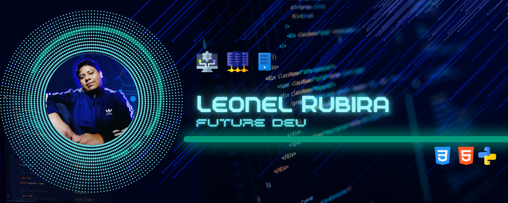

 

### 👨🏻‍💻 &nbsp;Sobre Mí

💼 &nbsp;Actualmente trabajo en RP3 Retail como **Analista de Soporte Técnico** desde marzo 2015.\
💡 &nbsp;Me apasiona la administración de servidores, virtualización y soluciones tecnológicas empresariales.\
🎓 &nbsp;Estoy cursando Desarrollo de Software en el Instituto Superior Tecnológico Bolivariano De Tecnología.\
🌱 &nbsp;Continuamente actualizo mis conocimientos en Windows Server, Hyper-V, Veeam Backup y arquitectura de redes.\
🔧 &nbsp;Más de 10 años de experiencia en soporte técnico, administración de infraestructura TI y atención al cliente.\
💬 &nbsp;Disponible para consultas sobre administración de servidores Windows, virtualización y respaldos empresariales.\
✉️ &nbsp;Puedes contactarme en yaba09@gmail.com\
📄 &nbsp;Revisa mi perfil completo para conocer más sobre mi experiencia profesional.

## 💻 Tecnologías y Herramientas que Domino

 

### Sistemas Operativos y Servidores

 
 

### Bases de Datos

 
 

### Lenguajes de Programación (Nivel Básico)

 
 

### Diseño Gráfico y Multimedia (Nivel Básico)

 

---

## 💼 Experiencia Profesional

### 🔹 Analista de Soporte Técnico | RP3 Retail
**Marzo 2015 - Presente**

- Soporte técnico a usuarios y administración de equipos de cómputo
- Administración e instalación de Servidores Windows Server
- Configuración y administración de Base de Datos SQL Server
- Gestión de respaldos con Veeam Backup y Hyper-V
- Administración de servidores QNAP para almacenamiento empresarial
- Configuración y preparación de equipos para usuarios finales

### 🔹 Técnico en Mantenimiento | SONDA del Ecuador
**Diciembre 2011 - Diciembre 2012**

- Soporte técnico y mantenimiento preventivo de equipos
- Gestión de garantías y reparación de hardware
- Atención directa a usuarios finales

### 🔹 Analista Técnico | Farcomed (FYBECA)
**Noviembre 2009 - Octubre 2011**

- Mantenimiento correctivo de equipos de cómputo
- Instalación y configuración de servidores y equipos especializados
- Soporte técnico a nivel empresarial

### 🔹 Técnico | EBC - Coca Cola
**Noviembre 2007 - Noviembre 2008**

- Soporte en aplicaciones empresariales: Basis, Sigma, Lotus Notes
- Gestión de backups en tiempo real
- Desarrollo de soluciones tecnológicas

---

## 🎓 Educación y Certificaciones

### 📚 Formación Académica

**Desarrollo de Software** - *En Curso*  
Instituto Superior Tecnológico Bolivariano De Tecnología (2024 - Presente)

**Programador en Sistemas** - *Abandonado*  
ESPOL (2003)

### 🏆 Certificaciones y Cursos

- **VEEAM Backup & Replication V12 Administration** - Udemy (2024)
- **Windows Server 2019 Administration** - Udemy (2023)
- **Arquitectura de Redes** - Udemy (2023)
- **Virtualización con Hyper-V en Windows Server** - Udemy (2022)
- **Certificación de Equipo HP**

---

## 🌟 Habilidades Técnicas

### Nivel Intermedio
- Office Suite
- Herramientas Gráficas
- Software de Gestión
- Windows Server Administration
- HP Equipment Management

### Nivel Básico
- **Programación:** HTML5, CSS3, Python, Java
- **Diseño Gráfico:** Adobe Illustrator, Photoshop, After Effects, Affinity Designer
- Desarrollo de Software
- Inglés (Escrito y Oral)

### Especialidades
- Administración Windows Server 2019
- Administración Hyper-V Windows Server
- Software de Edición de Audio y Video
- Sistemas Operativos multiplataforma

---

## 🎯 Objetivo Profesional

> *"Busco oportunidades que me desafíen y me permitan crecer profesionalmente en un entorno dinámico y colaborativo."*

---

## 📊 Información Personal

📱 **Teléfono:** +593990122347
📧 **Email:** yaba09@gmail.com  
📍 **Ubicación:** Avenida Casuarina, Guayaquil, Guayas, Ecuador  
🎂 **Fecha de Nacimiento:** 02-10-1982  

---

## 🤝🏻 &nbsp;Conecta Conmigo

---

  
### 💼 Profesional en TI | 🖥️ Administración de Servidores | ☁️ Virtualización | 💾 Respaldos Empresariales

*Más de 10 años de experiencia proporcionando soluciones tecnológicas confiables*

---

  

---

**Crédito:** [Leonel Rubira Quimi](https://github.com/leonelrubira)  
**Última actualización:** 06/11/2025

